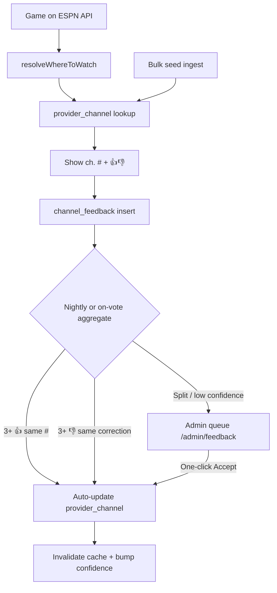

# TunedTV — Channel data: gather, correct, automate

Last updated: 2026-05-27  
Goal: **you should not be the only human in the loop.** Seed data gets us started; users + automation keep it accurate.

---

## 🔔 REMIND ME LATER — when Apple approves

**Say in chat:** `go post-launch`

That triggers the full queue in order. For **channel data specifically**, you want **#10 → #14 (admin) → #19 → #20**.

| Step | What | Your action |
|------|------|-------------|
| 1 | **#10** — Fios TNT **753 → 551**, Prime/Max cleanup | Lovable publish — smoke test CAR @ MTL |
| 2 | **#14** — Admin grant SQL | You run once in Supabase → open `/admin/feedback` |
| 3 | **#19** — Leaderboard tally | Lovable — your 👍 should bump Top score |
| 4 | **#20** — Auto-promote | Lovable + Edge Function — **3 users agree → DB updates itself** |
| 5 | **Phase 3** — Fios PDF bulk import | One-time script — fixes all Fios national nets |

**Until then:** 👎 bad rows, don’t Lovable-publish. Pinned fix: **Fios TNT 551 not 753**.

---

## After launch — full explanation

### Why this matters

TunedTV’s edge is **crowdsourced channel accuracy**. Competitors show network names; you show **“ESPN · ch. 570 on *your* Fios.”** Seed data gets you live on day one; **users + automation** make it trustworthy without you editing thousands of rows.

### The flywheel (what you’re building toward)

1. **User finds a game** → app shows channel # from `provider_channel` (seed).
2. **User taps 👍 or 👎** → saved to `channel_feedback` with ZIP, provider, DMA, what we showed, optional correction.
3. **System aggregates** → same provider + market + network + suggested number gets counted.
4. **Auto-promote (#20)** → when **3+ users agree** (or 75%+ 👍 on the same number), `provider_channel` updates overnight — no SQL from you.
5. **Leaderboard (#19)** → verifiers earn points → more people verify → faster fixes.
6. **You only handle disputes** — split votes, weird RSN cases, new providers — via `/admin/feedback` or a weekly email digest.

### Launch week timeline (realistic)

**Day 0 — Approved**  
- Paste **`go post-launch`** → Batch A (perf/tabs) publishes first.  
- Smoke test: cold start, tab switching, demo login.

**Day 1–2 — Accuracy pass**  
- **#10** ships: Fios TNT shows **551**, HBO Max chip gone on Warner games, one Prime label.  
- You run **admin SQL (#14)** — takes 30 seconds.  
- Open `tunedtv.com/admin/feedback` — you can Accept/Reject 👎 reports.

**Day 3–5 — Gamification + automation**  
- **#19**: vote on a game → **Top** tab score moves within seconds.  
- **#20**: auto-promote job goes live. From here, **every 👍/👎 from real users trains the database**. Your job shifts from “fix every channel” to “watch the digest.”

**Week 2+ — Bulk seed (optional but high leverage)**  
- Parse Verizon’s [Fios channel PDF](https://www.verizon.com/content/dam/verizon/support/consumer/documents/verizon_consumer_fios_tv_channel_lineup.pdf) once → upsert ESPN, TNT, truTV, TBS, FS1, etc. for **all Fios users nationally**.  
- Same pattern later for Xfinity/DirecTV where lineups are stable.

### What you do vs what the system does

| Task | Before #20 | After #20 |
|------|------------|-----------|
| Wrong TNT on Fios | You run SQL or Lovable | 3 users 👎 “551” → auto-fix |
| New provider request | Email → you research | Email + queue; bulk import when ready |
| Disputed row (50/50 votes) | — | Admin queue; one-click Accept |
| Leaderboard motivation | Broken (#19) | Points for every verify |
| Your weekly time | 30+ min triage | ~5 min on disputes only |

### What “good” looks like in 30 days

- National nets on Fios/Xfinity/DirecTV **mostly correct** from bulk import + early verifiers.  
- **Dense markets** (NY, LA, Chicago) self-correct via game-night 👍 waves.  
- **RSN gaps** still honest (“Not on your services”) until territory data grows.  
- You’re **not** the bottleneck — you’re reviewing exceptions.

### If you forget

Open this file or master todo — top line says **Fios TNT 551** and **`go post-launch`**. Or ask in chat: *“What’s the post-launch channel data plan?”*

---

## 📌 Pinned reminder (fix when approved)

| Provider | DMA / ZIP | Network | App shows | Correct | Status |
|----------|-----------|---------|-----------|---------|--------|
| **Fios** | 11518 (NY) | **TNT** | ch. **753** | ch. **551 HD** | User verified 2026-05-27 — fix in **#10** post-approval |
| Fios | 11518 | truTV | ch. 683 | ch. 683 | ✅ OK |

**SQL (one-off after approve):**
```sql
UPDATE public.provider_channel
SET channel_number = '551', source = 'user_verified', updated_at = now()
WHERE provider = 'fios' AND network = 'TNT' AND channel_number = '753';
-- Prefer dma_id for NY DMA if row exists; else national default (dma_id NULL).
```

---

## The problem

Channel numbers vary by **provider × DMA × package**. There is no cheap universal API. Early seed used **~90 national defaults** — wrong for many markets (753 vs 551 is one example).

**You cannot manually fix every ZIP.** The product loop must be:

```
Seed (imperfect) → Users verify → System aggregates → Auto-apply or admin one-click → Live data improves
```

---

## What exists today

| Piece | Status |
|-------|--------|
| `provider_channel` table | Seed + lookup cache |
| `channel_feedback` | 👍/👎 + optional correction, ZIP/provider/DMA metadata, dedupe |
| 👎 email → support@ | Works |
| `/admin/feedback` | Built — **needs your admin grant (#14)** |
| Leaderboard / points | Votes save on card; **profile score not wired (#19)** |
| Apply correction → DB | **Manual** — no auto-promote yet |

---

## Target pipeline (automated)



### Confidence on every mapping

Add (or use) fields on `provider_channel`:

| Field | Use |
|-------|-----|
| `source` | `seed` \| `bulk_import` \| `auto_promoted` \| `admin` \| `user_verified` |
| `confirmation_count` | 👍 on this exact row |
| `dispute_count` | 👎 count |
| `confidence` | 0–1 derived score |
| `last_verified_at` | Most recent 👍 |

**Display rules:**

- `confidence >= 0.7` → show **ch. ###** with green “On {provider}”
- `0.4–0.7` → show number + “Unverified” or muted styling
- `< 0.4` or dispute majority → hide number, show “Verify this channel” or “Not confirmed for your area”

---

## Automation phases (build order)

### Phase 0 — You, this week (no Lovable publish during review)

1. **Grant admin** (#14) — run SQL in master todo → open `/admin/feedback`
2. When 👎 emails arrive: **Accept** → update `provider_channel` (until Phase 2 exists)
3. Log every manual fix in this doc’s table below (or a Google Sheet)

### Phase 1 — Post-approval quick wins (#10, #14, #19)

- Fix known bad seeds (Fios TNT 753→551, HBO Max chip, Prime dedupe)
- Wire **leaderboard tally** so verifiers get credit → encourages crowd
- **One-click “Apply to provider_channel”** on `/admin/feedback` (if not already)

### Phase 2 — Auto-promote (Lovable **#20** — highest ROI automation)

**Edge function or DB job** (hourly or nightly):

```
For each (provider, dma_id, network):
  - Count 👍 where displayed_channel matches provider_channel.channel_number
  - Count 👎 with same suggested_channel (e.g. "551")
  - If 👍 >= 3 AND 👍/(👍+👎) >= 0.75 → auto-update channel_number, source=auto_promoted
  - If 👎 >= 3 with SAME suggested_channel → auto-update to that number
  - If conflicting suggestions → flag needs_review, email digest to support@
```

**On successful 👍** (real-time, lighter):

- Increment `confirmation_count` on matching `provider_channel` row
- Increment `profiles.verification_count` (#19)

**Copy-paste to Lovable (post-approval, after #10):**

```
Channel data auto-promote (#20):

1. After channel_feedback insert, bump matching provider_channel.confirmation_count 
   (provider + dma_id + network + displayed_channel match).

2. Nightly Edge Function aggregate_channel_feedback:
   - Group by provider, dma_id, network
   - Auto-update provider_channel when >=3 votes agree on channel number 
     (>=75% positive OR >=3 identical suggested_channel on 👎)
   - Set source='auto_promoted', update confidence score
   - Invalidate provider channel cache

3. Split votes → leave row unchanged, set low confidence, surface in /admin/feedback

4. Email support@ daily digest: auto-applied changes + disputed rows (max 20 lines)

Test: 3 test users 👍 Fios TNT 551 in same DMA → provider_channel updates from 753 to 551 
without manual SQL.
```

### ZIP bundling — apply corrections to surrounding markets (#20b, with #20)

**Problem:** If corrections apply only to the voter’s ZIP, 11518 fixed but 11509 still wrong — even though both share the same lineup (same DMA + provider).

**Rule:** ZIP is **audit metadata** on `channel_feedback`. Live lookup and auto-promote use **`(provider, dma_id, network)`** — never per-ZIP in `provider_channel`.

| Scope | When to use |
|-------|-------------|
| **`dma_id` + provider** | Default — votes in 11518, 11509, 11572 (same DMA) aggregate together |
| **`dma_id NULL` + provider** | National nets same everywhere (Fios ESPN 570, Golf 593) — promote when 3+ users across DMAs agree |
| **Per-ZIP row** | ❌ Do not use for live channel lookup |

**Promote thresholds:**

| Votes | Action |
|-------|--------|
| 1 correction in a ZIP | Save feedback only; optional admin flag |
| 3+ same correction, **same DMA** | Auto-update `provider_channel` for **whole DMA** |
| 3+ same correction, **multiple DMAs**, national provider | Update national row (`dma_id NULL`) |
| Split votes in DMA | Low confidence + `/admin/feedback` |

**Provider defaults:** Fios/DirecTV/Dish → try national first, DMA override if votes disagree. Spectrum/Cox/Xfinity → **DMA-first**.

**Optional later:** UI hint “Verified in your area” when same-DMA users agreed — no haversine ZIP math; DMA is the bundle.

**Copy-paste add-on for Lovable (#20):**

```
ZIP bundling (#20b): Store zip on channel_feedback for audit only.
Aggregate and apply corrections at (provider, dma_id, network) — NOT per zip.
National provider_channel rows use dma_id NULL when lineup is provider-wide.
Test: user in 11518 + user in 11509 (same DMA) 👎 TNT→551 → one DMA row updates.
```

**Hold until post-approval** — ship with or immediately after #20.

### Phase 3 — Bulk seed ingest (reduce manual entry)

**Fios:** One [Verizon consumer PDF](https://www.verizon.com/content/dam/verizon/support/consumer/documents/verizon_consumer_fios_tv_channel_lineup.pdf) covers **all** Fios markets — same numbers nationally for national nets (TNT 551, truTV 683, ESPN 570, etc.).

| Approach | Effort | Payoff |
|----------|--------|--------|
| **Script: parse Verizon PDF → CSV → Supabase** | 1–2 days once | Fixes entire Fios national row set |
| CSV template per provider | Repeatable | You or VA paste from provider sites |
| Supabase `import_provider_channels` RPC | Small | Upsert by (provider, dma, network) |

**Not fully automatable (yet):** Spectrum/Cox per-DMA lineups, RSN by territory, package tiers (sports tier vs basic).

### Phase 4 — Smarter inputs (later)

| Idea | Notes |
|------|-------|
| **Disputed badge on card** | 👎 > 👍 on displayed # → warn before user trusts it |
| **“Same as last week?”** | After big game, prompt returning verifiers |
| **Provider lineup scrape** | ToS + breakage risk; use for **diff alerts** only, not live lookup |
| **LLM triage in admin** | “3 users in 11518 say 551 — recommend Accept” |
| **Founding contributor tier** | Already planned — reward early verifiers in dense markets |

---

## Your weekly habit (until Phase 2 ships)

| Day | Action | Time |
|-----|--------|------|
| Mon | Scan support@ for 👎 channel emails | 10 min |
| Wed | `/admin/feedback` — Accept/Reject queue | 15 min |
| Fri | Add new rows to “Pinned fixes” table in this doc | 5 min |

**After Phase 2:** Weekly digest only — intervene on **disputed** rows.

---

## Manual fix log (living)

| Date | Provider | ZIP/DMA | Network | Was | Now | How |
|------|----------|---------|---------|-----|-----|-----|
| 2026-05-27 | Fios | 11518 | TNT | 753 | **551** | User verified — apply in #10 |
| 2026-05-29 | Fios | 11518 | MIA @ NYM (local) | ESPN **570** | **ch. 11** | User verified — national ESPN tag wrong; local broadcast (#10) |
| 2026-05-30 | Fios | 11518 | SNY | **578** | **577** | User verified Fios guide — MIA @ NYM on SNY 577 (#10) |

---

## Links

- Master fix order: `docs/TunedTV-master-todo.md` (#10, #14, #19, **#20**)
- Lovable ops prompts: `docs/lovable-prompts-may2026.md`
- Admin grant SQL: bottom of master todo
